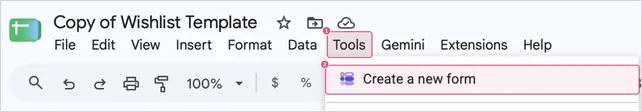
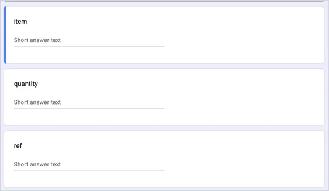

# Gift claiming

[← Back to the README](../README.md)

Gift claiming adds a button to every item so gift-givers can mark what they bought. Everyone else sees how many are left, and an item greys out and moves to the end once it's taken, so nobody buys the same thing twice. You won't see what was bought unless you go looking.

The button's wording depends on your theme: "I bought this", "Loot", "Claim it", "I got this!".

## Turn it on

You'll make your own small claim form (it takes a few minutes), and your sheet does the rest.

**1. Create your claim form.** In your sheet, go to **Tools → Create a new form**.



Google makes a new form that's already connected to your sheet, opens it in a new browser tab, and adds a tab called **Form Responses 1** to your sheet.

**2. Add three questions.** Give the form any title you like, like "Wishlist claims". Then make three **Short answer** questions named exactly **item**, **quantity** and **ref**, in that order:



- The form starts with one "Untitled Question". Rename it to **item** and change its type to **Short answer**.
- Click **⊕** (Add question) on the right for the other two.
- Leave them all optional (don't switch on **Required**).

**3. Copy its pre-filled link.** In the form, click **⋮** (top right) → **Pre-fill form**.


A copy of the form opens. Type anything into the three boxes (the words don't matter), click **Get link**, then **COPY LINK** in the bar at the bottom left.


> [!NOTE]
> It has to be this pre-filled link. The form's regular share link doesn't include the question details the site needs, and the setup check (`?check`) will tell you if the wrong one got pasted.

**4. Paste it and switch it on.** Back in your sheet, on the **Settings** tab, paste the link into **Claim form link** and tick **Enable item claiming**.

**5. Hide the responses tab.** Right-click the **Form Responses 1** tab at the bottom and choose **Hide sheet**. It shows what people bought.

The buttons appear on your site within about 5 minutes. Open your site with `?check` on the end to confirm everything's connected.

> [!WARNING]
> Don't change or reorder the form's three questions (item, quantity, ref). The site depends on them. Renaming the form is fine.

<details>
<summary>My responses tab isn't called "Form Responses 1"</summary>
<br>

That happens if your sheet ever had another form. Your sheet has a hidden **Claimed items (Warning Spoilers!)** tab that copies purchases from "Form Responses 1". Unhide it (☰ at the bottom left), change the tab name in cell **A1** to match yours (for example `={'Form Responses 2'!A:D}`), and hide it again.

No hidden Claimed items tab at all? Open your responses tab, copy the address from your browser, and paste it into a Settings row named `Claims tab link`.

</details>

## Keep the surprise

Purchases are recorded in your **Form Responses 1** tab and copied into the hidden **Claimed items (Warning Spoilers!)** tab, which your site reads. Keep both hidden: hidden tabs show up greyed out in the sheet's list of tabs (the ☰ button at the bottom left).


On each of your own phones and computers, open your site once with `?shield` added to the end of the address:

```
https://your-username.github.io/wishlist/?shield
```

That browser will hide everything that's been bought from then on. Use `?shield=off` to undo it.

> [!TIP]
> Want to try the button without recording anything? Add `?test-claims` to the address instead. Nothing gets sent, so you can click around freely.

## Fixing mistakes

A gift-giver can press **Undo** right after marking something. For anything else, someone needs to delete that row in the **Form Responses 1** tab. Ask a partner or friend to do it so you don't see the spoiler.

## Turning it off

Untick **Enable item claiming** on the Settings tab.

## Using your own form

If your sheet doesn't have the hidden Claimed items tab (for example, you copied it before October 15, 2026), make a Google Form with three short-answer questions, in this order: **item**, **quantity** and **ref**.

- Don't add number-only rules to quantity, because Undo sends a negative number.
- Don't require sign-in.

Then link it to a sheet (**Responses → Link to Sheets**), publish that sheet (**File → Share → Publish to web → Comma-separated values**), and fill in the `claims` section of `config.js`:

| Setting | Where it comes from |
|---|---|
| `csvUrl` | The responses sheet's published link |
| `formUrl` | The form's pre-filled link, with `viewform?…` changed to `formResponse` |
| `itemField`, `qtyField`, `refField` | The `entry.123456` numbers in the pre-filled link, in question order |
