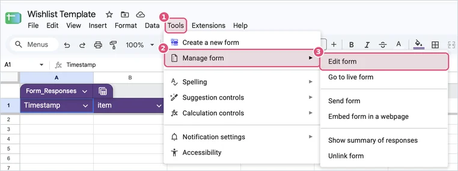
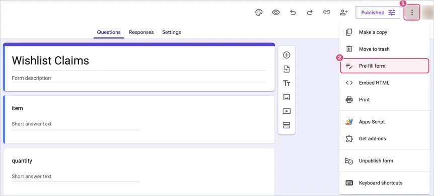

# Gift claiming

[← Back to the README](../README.md)

Gift claiming adds a button to every item so gift-givers can mark what they bought. Everyone else sees how many are left, and an item greys out and moves to the end once it's taken, so nobody buys the same thing twice. You won't see what was bought unless you go looking.

The button's wording depends on your theme: "I bought this", "Loot", "Claim it", "I got this!".

## Turn it on

Your copy of the template sheet came with its own claim form. It's already connected to a hidden **Claimed Items Log** tab, so there are only three steps.

**1. Open your claim form.** In your sheet, go to **Tools → Manage form → Edit form**. (You can also find "Copy of Wishlist claims" in your Google Drive.)



**2. Copy its pre-filled link.** In the form editor, click **⋮** (top right) → **Pre-fill form**.



A copy of the form opens. Type anything into the three boxes (the words don't matter), click **Get link**, then **COPY LINK** in the bar at the bottom left.


> [!NOTE]
> It has to be this pre-filled link. The form's regular share link doesn't include the question details the site needs, and the setup check (`?check`) will tell you if the wrong one got pasted.

**3. Paste it and switch it on.** On your sheet's **Settings** tab, paste the link into **Claim form link** and tick **Enable item claiming**.

The buttons appear on your site within about 5 minutes.

> [!WARNING]
> Don't change or reorder the form's three questions (item, quantity, ref). The site depends on them. Renaming the form is fine.

## Keep the surprise

Purchases are recorded in the hidden **Claimed Items Log** tab. It shows up greyed out in the sheet's list of tabs (the ☰ button at the bottom left). Leave it hidden.


On each of your own phones and computers, open your site once with `?shield` added to the end of the address:

```
https://your-username.github.io/wishlist/?shield
```

That browser will hide everything that's been bought from then on. Use `?shield=off` to undo it.

> [!TIP]
> Want to try the button without recording anything? Add `?test-claims` to the address instead. Nothing gets sent, so you can click around freely.

## Fixing mistakes

A gift-giver can press **Undo** right after marking something. For anything else, someone needs to delete that row in the Claimed Items Log. Ask a partner or friend to do it so you don't see the spoiler.

## Turning it off

Untick **Enable item claiming** on the Settings tab.

## Using your own form

If your sheet doesn't have the built-in form (for example, you copied it before claiming existed), make a Google Form with three short-answer questions, in this order: **item**, **quantity** and **ref**.

- Don't add number-only rules to quantity, because Undo sends a negative number.
- Don't require sign-in.

Then link it to a sheet (**Responses → Link to Sheets**), publish that sheet (**File → Share → Publish to web → Comma-separated values**), and fill in the `claims` section of `config.js`:

| Setting | Where it comes from |
|---|---|
| `csvUrl` | The responses sheet's published link |
| `formUrl` | The form's pre-filled link, with `viewform?…` changed to `formResponse` |
| `itemField`, `qtyField`, `refField` | The `entry.123456` numbers in the pre-filled link, in question order |
